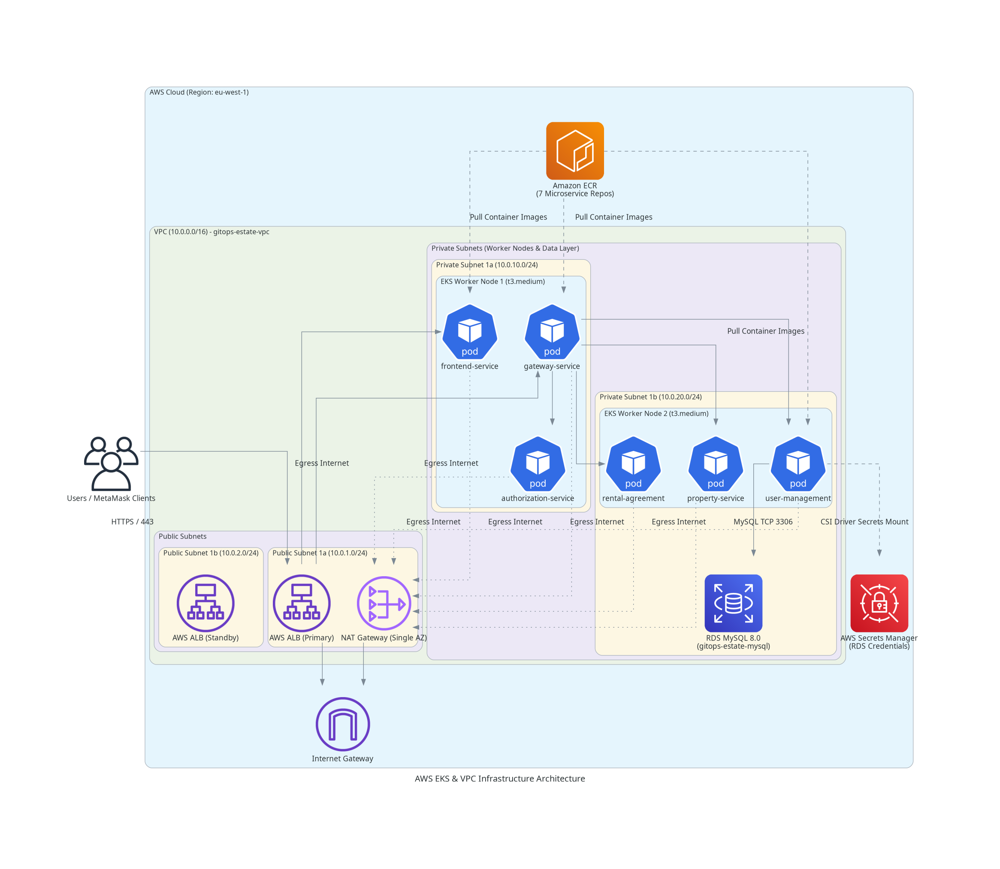
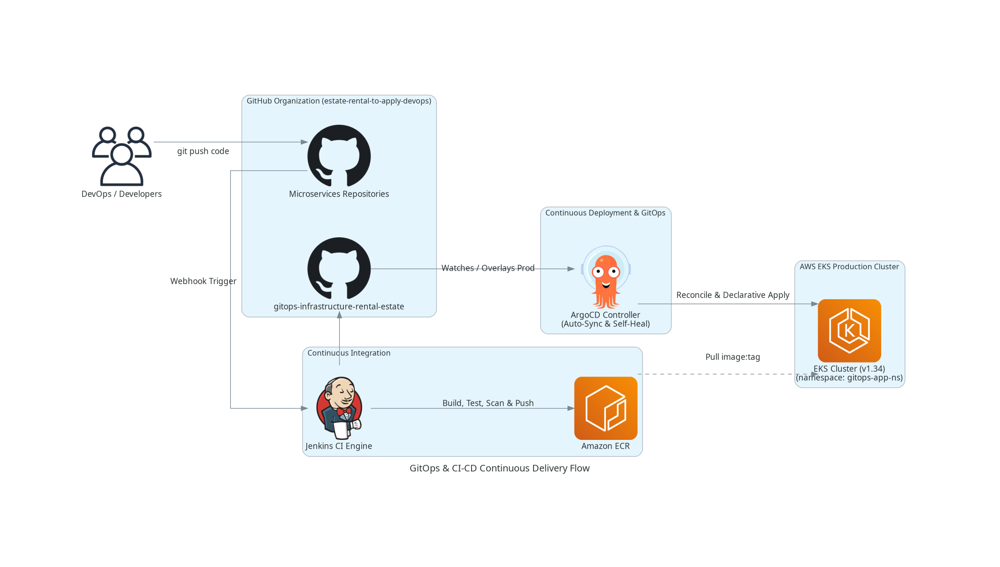
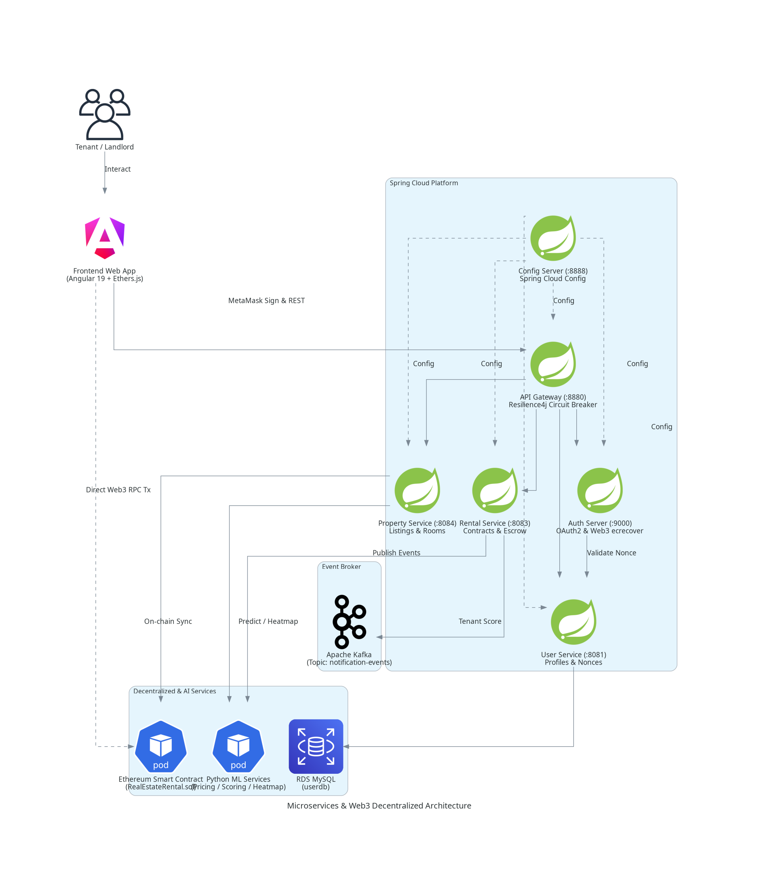

# 🏡 Estate Rental DevOps — Decentralized Real Estate Platform
### Official GitHub Organization Profile: [`@estate-rental-to-apply-devops`](https://github.com/estate-rental-to-apply-devops)

Welcome to the **Estate Rental DevOps** organization. This ecosystem represents an end-to-end, enterprise-grade cloud-native real estate platform uniting **Spring Boot microservices**, **Ethereum smart contracts**, **Machine Learning AI models**, and an **Angular 19+ (Nx Monorepo)** frontend. 

The entire platform is automated using **GitOps (ArgoCD, Helm, Kustomize)** and deployed to **AWS EKS** via **Terraform Infrastructure as Code (IaC)**.

---

## ☁️ 1. AWS Cloud & VPC Infrastructure Topology

The production infrastructure is deployed in Ireland (`eu-west-1`) using **HashiCorp Terraform** and official AWS registry modules.

### 🌐 VPC & Network Architecture Details
- **VPC CIDR**: `10.0.0.0/16` (`65,536` IP addresses) across 2 Availability Zones (`eu-west-1a`, `eu-west-1b`).
- **Public Subnets**:
  - `eu-west-1a`: `10.0.1.0/24` (Hosts the Single NAT Gateway & primary ALB listener)
  - `eu-west-1b`: `10.0.2.0/24` (Hosts standby ALB listener for high availability)
  - Tagged with `kubernetes.io/role/elb = 1` for automatic AWS Load Balancer Controller discovery.
- **Private Subnets (Isolated EKS & Data Layer)**:
  - `eu-west-1a`: `10.0.10.0/24` (EKS managed worker nodes)
  - `eu-west-1b`: `10.0.20.0/24` (EKS managed worker nodes & private RDS MySQL 8.0)
  - Zero direct public internet ingress; outbound traffic routes securely through the single NAT Gateway.
- **EKS Cluster (Kubernetes v1.34)**:
  - Multi-AZ worker nodes (`t3.medium`) managed via EKS Node Groups.
  - Managed add-ons: AWS VPC-CNI, CoreDNS, Kube-Proxy, and EBS CSI Driver.
- **Zero-Trust Security & IRSA (IAM Roles for Service Accounts)**:
  - **AWS Load Balancer Controller**: Managed via IRSA to dynamically provision Application Load Balancers for Ingress.
  - **Secrets Store CSI Driver**: Injects database master credentials from **AWS Secrets Manager** (`gitops-estate-mysql-credentials`) directly into pod memory without plain text secrets.
- **Amazon ECR**: 7 container repositories with AES-256 encryption, push-time vulnerability scanning, and lifecycle cleanup policies deleting untagged images older than 1 day.

---

## 🔄 2. GitOps Continuous Delivery & CI/CD Flow

All deployments follow the declarative **GitOps** model: the desired cluster state is stored entirely in Git, and **ArgoCD** continuously reconciles the cluster to eliminate configuration drift.

### 🔁 Delivery Pipeline Stages
1. **Developer Push**: A commit is pushed to any microservice repository in the organization.
2. **Continuous Integration (Jenkins)**:
   - Deep clones the repository and runs unit/integration test suites.
   - Executes static analysis and code quality gates via **SonarQube**.
   - Builds optimized multi-stage Docker images tagged with the 7-character Git commit SHA.
   - Pushes container images to **Amazon ECR** (`gitops-estate/<service>:<git-sha>`).
3. **GitOps Manifest Update**: Jenkins opens an automated pull request/commit to update image tags in [`gitops-infrastructure-rental-estate`](https://github.com/estate-rental-to-apply-devops/gitops-infrastructure-rental-estate).
4. **Declarative Synchronization (ArgoCD)**:
   - ArgoCD monitors the GitOps repository for changes.
   - On detecting drift, ArgoCD applies the Kustomize production overlay (`kustomize/overlays/prod`) to AWS EKS.
   - EKS performs rolling zero-downtime updates, pulling the new image from ECR.

---

## 🧩 3. Microservices, Web3 & AI Architecture

The application combines high-throughput reactive Java backends, Web3 smart contract decentralization, and predictive machine learning models.

### 🛠 Core Application Components
- **[Frontend (Angular 19+ Nx Monorepo)](https://github.com/estate-rental-to-apply-devops/frontend)**:
  - Built with Angular standalone components, Tailwind CSS, Leaflet maps, and **Ethers.js v6**.
  - Connects to MetaMask for decentralized cryptographic wallet signatures.
- **[API Gateway (Spring Cloud Gateway)](https://github.com/estate-rental-to-apply-devops/gateway-service)**:
  - Central reverse proxy running on port `8880`.
  - Handles JWT Token Relay, CORS negotiation, and **Resilience4j Circuit Breakers** (with sliding count windows and automated fallback routing).
- **[Authorization Server (Spring Authorization Server)](https://github.com/estate-rental-to-apply-devops/authorization-estate-renatl-service)**:
  - Implements custom Web3 OAuth2 grant types (`metamask`).
  - Verifies ECDSA signatures using `Web3j` (`ecrecover`), validates one-time nonces against the User Service to eliminate replay attacks, and signs JWT tokens using RSA-256 keypairs.
- **[User Management Service](https://github.com/estate-rental-to-apply-devops/user-management-estate-rental-service)**:
  - Manages tenant, landlord, and administrator profiles in MySQL.
  - Generates, verifies, and invalidates authentication nonces.
- **[Property Management Service](https://github.com/estate-rental-to-apply-devops/property_management_service)**:
  - Manages real estate properties, room subdivisions, and photo assets (stored in Supabase/Cloudinary).
  - Synchronizes listings with on-chain IDs in the **`RealEstateRental.sol`** Ethereum smart contract.
  - Queries ML services via OpenFeign for price suggestions and demand heatmaps.
- **[Rental Agreement Service](https://github.com/estate-rental-to-apply-devops/rental_agreement_service)**:
  - Manages rental applications, digital lease agreements, and smart contract escrow states.
  - Queries the ML Tenant Scoring service to evaluate tenant risk scores.
  - Publishes contract and payment lifecycle events to **Apache Kafka**.
- **[Config Service](https://github.com/estate-rental-to-apply-devops/config-service-rental-estate)**:
  - Spring Cloud Config Server running on port `8888`, providing centralized runtime configuration fetched from Git across `dev` and `prod` environments.

---

## 📚 Organization Repositories Index

| Repository | Purpose & Role | Tech Stack |
| :--- | :--- | :--- |
| **[`terraform_infra`](https://github.com/estate-rental-to-apply-devops/terraform_infra)** | AWS Infrastructure as Code (VPC, EKS 1.34, RDS MySQL, ECR, IAM, IRSA). | Terraform, AWS Modules |
| **[`gitops-infrastructure-rental-estate`](https://github.com/estate-rental-to-apply-devops/gitops-infrastructure-rental-estate)** | GitOps delivery repository with universal Helm chart and Kustomize overlays. | ArgoCD, Helm, Kustomize |
| **[`frontend`](https://github.com/estate-rental-to-apply-devops/frontend)** | Public-facing single-page application and shared UI library. | Angular 19, Nx, Ethers.js, Tailwind |
| **[`gateway-service`](https://github.com/estate-rental-to-apply-devops/gateway-service)** | Central API Gateway with Resilience4j circuit breakers and token relay. | Spring Cloud Gateway, WebFlux |
| **[`authorization-estate-renatl-service`](https://github.com/estate-rental-to-apply-devops/authorization-estate-renatl-service)** | Web3 MetaMask authentication server and OAuth2/OIDC JWT provider. | Spring Authorization Server, Web3j |
| **[`user-management-estate-rental-service`](https://github.com/estate-rental-to-apply-devops/user-management-estate-rental-service)** | User profiles and cryptographic nonce management. | Spring Boot, JPA, MySQL |
| **[`property_management_service`](https://github.com/estate-rental-to-apply-devops/property_management_service)** | Property catalog, Solidity smart contract (`RealEstateRental.sol`), ML clients. | Spring Boot, Solidity, Web3j |
| **[`rental_agreement_service`](https://github.com/estate-rental-to-apply-devops/rental_agreement_service)** | Lease agreements, escrow payment states, AI scoring, Kafka event publishing. | Spring Boot, Kafka, Resilience4j |
| **[`config-service-rental-estate`](https://github.com/estate-rental-to-apply-devops/config-service-rental-estate)** | Centralized runtime configuration server. | Spring Cloud Config Server |
| **[`shared-library-estate-rental`](https://github.com/estate-rental-to-apply-devops/shared-library-estate-rental)** | Jenkins shared pipeline library for standardized build/test/scan stages. | Groovy, Jenkins Pipeline |

---

> 📐 **Architecture Tooling Note**: The visual architecture diagrams in this profile were authored using **Diagrams as Code** ([`mingrammer/diagrams`](https://diagrams.mingrammer.com/)), leveraging official AWS, Kubernetes, and programming icon libraries to guarantee clean, programmatic, and version-controlled architectural blueprints.
